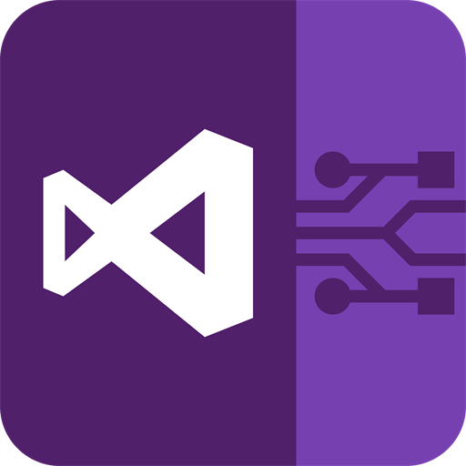

<div align="center">



# Visual Studio 2015 MCP

</div>

面向 Windows 的本地 stdio MCP 服务，用于在受控会话与显式身份校验下驱动 Visual Studio 2015（Update 3 / MSBuild 14）的构建、结构化诊断、调试、进程与性能采样、历史对照、常驻 IDE 自动化，以及 Windows Phone 8.1 / Windows 10 Mobile 模拟器操控、Device Portal 与客体 ETL 离线分析。

当前版本为 **v0.5.0**，提供 **94 项 MCP 工具**与 **6 份内置文档资源**（`vs2015://*`）。协议层基于官方 `@modelcontextprotocol/server` SDK，原生命令行通过 PowerShell 7 执行，XDE / CoreCon 的 x86 .NET Framework 程序集通过独立的 32 位 Windows PowerShell 5.1 进程调用，IDE 自动化通过按需编译的 x86 .NET Framework STA 桥接连接运行中的 VS2015。无需安装 VS 扩展，不自动下载 SDK/镜像/模型，也不调用外部 AI API。

仓库同时保留 [`windows81-metro-dev`](windows81-metro-dev/SKILL.md) 技能目录（Windows 8.1 Store / Windows Phone 8.1 Metro 应用开发规范与参考）。

## 核心能力

| 领域 | 工具数 | 主要能力 |
| --- | --- | --- |
| VS2015 CLI 与构建 | 8 | VS2015 与 SDK 发现、解决方案只读检查、工具帮助查询、MSBuild 14、devenv、VSTest、MSTest 与字面量原生 CLI 执行 |
| 编译诊断 | 2 | 基于 MSBuild 14 `ILogger` 的多节点结构化错误/警告/行列与目标耗时持久化及分页查询 |
| 常驻 IDE 自动化 | 33 | ROT 按 PID 与启动时间发现并租约 attach、配置/平台/启动项目切换、受保护项目属性与 Appx 清单身份读取、文本缓冲读取/冲突替换/原子增量编辑、事件驱动构建与协调、断点所有权隔离、线程/栈帧导航、表达式求值、暂停客体包身份核对与 WinRT XAML 树/动作操作 |
| 命令行调试 | 5 | CDB / WinDbg / VS 调试器发现、离线 dump 异常与 SOS 堆统计、非侵入式宿主快照、初始加载器断点快照、交互式 `devenv /DebugExe` 启动 |
| 进程采样与历史比较 | 12 | 宿主进程枚举、不可变实验历史与产物存储、CPU/内存/Framework CLR 采样与操作时间窗对齐、显式列映射 CSV 热点导入与口径一致的基线对比 |
| Performance Tools 与 ETL | 6 | 性能工具发现、VSPerf 权限/所有权受限 CPU 采集、VSP/VSPS 导出、VSPX/ETL.zip 安全提取，以及 PerfView 离线报告（含 `cpuStacks`、`cpuCsv`、`gcStats`、`eventsXml` 与 `appCpu` 包绑定原生热点归因） |
| 手机模拟器与部署 | 12 | XDE 与 CoreCon 设备发现（含 Hyper-V VM GUID）、启停、状态与 endpoint 读取、guest 像素输入与 PNG 截图、CoreCon 应用管理及 WP8.1 / Win10M 部署 CLI |
| 持久手机会话与 WPR / Portal | 16 | 绑定 XDE PID/启动时间/Hyper-V GUID/CoreCon/IDE 的持久 `PhoneSession`、会话内输入/截图/允许列表 IDE 路由、WP8.1 客体 WPR 启停与 ETL 下载，以及 Win10M Device Portal HTTPS 连接/配对/元数据读取与 WPR 采集下载 |

## 环境要求与功能边界

| 功能 | 运行环境与依赖 | 已验证范围与已知边界 |
| --- | --- | --- |
| 基础运行与 CI 单元测试 | Windows（实际服务运行）、Node.js `>=20`、PowerShell 7（`pwsh`） | GitHub Actions 在 Windows / Linux、Node 22 / 24 运行环境独立单元测试 |
| 桌面构建、诊断与 IDE 自动化 | Windows 10 22H2、VS2015 Update 3 及目标项目所需 SDK | 独立 Build Tools 2015（无完整 VS 安装）目前不在发现范围内 |
| CDB 调试与 PerfView 离线分析 | 微软 CDB / Windows Debuggers、PerfView；`appCpu` 需 PerfView 随附的 `TraceEvent` 与 x64 .NET Framework 4.8；原生热点解析需匹配模块 GUID/age 的本地 PDB | 提供校验脚本 `Get-PerfView.ps1 -Version 4.0.0` 与 `Get-WindowsDebugger.ps1`；未配置 OS 符号时不承诺 `!analyze` 根因判断；管理员 VSPerf 实时采集尚未在本机验证 |
| WP8.1 / Win10M 模拟器操控 | 对应 SDK 与镜像、Hyper-V、32 位 Windows PowerShell 5.1 | WP8.1 与 Win10M 14393 已验证构建、部署、guest 输入/截图、断点与同时运行双会话；通用 Win10M shell 触摸滑动未通过验证 |
| 客体 WPR 与 Device Portal | WP8.1 需 CoreCon developer agent；Win10M 需在设备预先开启开发者模式与 Device Portal 并完成配对 | WP8.1 已验证客体 WPR 启停、ETL 下载与事件解析；Win10M 14393 已验证非持久配对、`GeneralProfile.wprp` 采集、HTTPS 在线下载及 `appCpu` 原生热点归因。手机托管堆/CLR/JIT 与系统符号覆盖仍未验证 |

## 安装与配置

### 1. 获取源码

从 [GitHub Releases](https://github.com/A-BenLi06/VS2015-MCP/releases) 下载对应版本的 **Source code (zip)** 并解压，或克隆本仓库：

```powershell
git clone https://github.com/A-BenLi06/VS2015-MCP.git
Set-Location .\VS2015-MCP\visual-studio-2015-mcp
```

若使用 Release 压缩包，请在解压后的仓库根目录进入服务目录：

```powershell
Set-Location .\visual-studio-2015-mcp
```

### 2. 安装生产依赖并生成 MCP 客户端配置

在 PowerShell 7 中执行：

```powershell
npm ci --omit=dev
pwsh -NoProfile -File .\scripts\Print-McpConfig.ps1
```

`Print-McpConfig.ps1` 只输出使用本机绝对路径的 `mcpServers` JSON 配置，不会修改任何客户端配置文件或系统环境变量。将其输出的 `command`、`args` 与 `env` 合并到你的 MCP 客户端配置即可。

### 3. 按需获取 PerfView 与 CDB（可选）

如果需要使用离线 ETL 报告（`vs2015_perfview_report`）或命令行 dump/快照分析（`vs2015_debug_*`），而本机尚未配置对应工具，可使用随附脚本安装到独立用户目录（不修改 `PATH` 或注册表）：

```powershell
pwsh -NoProfile -File .\scripts\Get-PerfView.ps1 -Version 4.0.0
pwsh -NoProfile -File .\scripts\Get-WindowsDebugger.ps1
```

随后将返回路径传给配置生成脚本：

```powershell
pwsh -NoProfile -File .\scripts\Print-McpConfig.ps1 `
  -PerfViewPath <PerfView.exe路径> `
  -DebuggerRoot <CDB目录> `
  -HistoryRoot <历史目录>
```

### 4. 核对连接

从普通 PowerShell 环境启动 MCP 客户端（避免继承其他 VS 版本 Developer Prompt 的 `INCLUDE`/`LIB`/`PATH`）。连接后先调用 `vs2015_discover`，确认已正确识别本机 VS2015 安装路径、工具链与 SDK 组件。

## 仓库结构

- [`visual-studio-2015-mcp/`](visual-studio-2015-mcp/README.md)：MCP 服务源码（`src/`）、PowerShell / C# 桥接与分析脚本（`scripts/`、`ide-bridge/`）、专题指南（`docs/`）及测试套件（`test/`）
- [`windows81-metro-dev/`](windows81-metro-dev/SKILL.md)：Windows 8.1 / Windows Phone 8.1 Metro 开发规范与平台参考技能
- [`.github/workflows/unit-tests.yml`](.github/workflows/unit-tests.yml)：跨平台环境独立单元测试工作流
- [`CHANGELOG.md`](CHANGELOG.md)：版本变更记录与 Release Notes
- [`walkthrough.md`](walkthrough.md)：开发与实机验证工程日志
- [`LICENSE`](LICENSE)：MIT 许可证

## 专题文档与资源

详细工具参数、执行语义、验证证据与版本限制见以下文档（前 6 份亦作为 MCP resources `vs2015://<name>` 暴露给客户端）：

- [完整安装、环境变量与 94 项工具清单](visual-studio-2015-mcp/README.md)
- [命令行构建指南](visual-studio-2015-mcp/docs/cli-guide.md)（`vs2015://cli-guide`）
- [VS2015 IDE 自动化指南](visual-studio-2015-mcp/docs/ide-guide.md)（`vs2015://ide-guide`）
- [命令行调试指南](visual-studio-2015-mcp/docs/debug-guide.md)（`vs2015://debug-guide`）
- [编译诊断、性能采集与历史比较指南](visual-studio-2015-mcp/docs/diagnostics-performance.md)（`vs2015://diagnostics-performance`）
- [Windows Phone 8.1 与 Windows 10 Mobile 模拟器指南](visual-studio-2015-mcp/docs/phone-guide.md)（`vs2015://phone-guide`）
- [手机客体性能接入现状与实测](visual-studio-2015-mcp/docs/mobile-performance.md)（`vs2015://mobile-performance`）
- [v0.5.0 Release Notes](CHANGELOG.md)

## 验证与测试

在 `visual-studio-2015-mcp` 目录可运行：

```powershell
npm test
npm run test:integration
npm run test:cancellation
```

其中 `npm test` 为环境独立单元测试（含需显式环境变量 `VS2015_TEST_INSTALLED_SDK=1` 才会启用的已安装 SDK 用例）；集成测试与实机手机/IDE/Portal 回归默认跳过外部依赖操作，仅在显式配置自有测试上下文时执行。

## 许可证

本项目基于 [MIT License](LICENSE) 开源。
